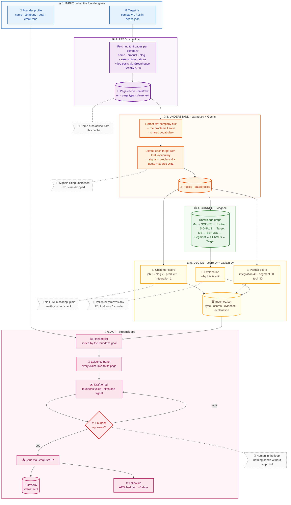
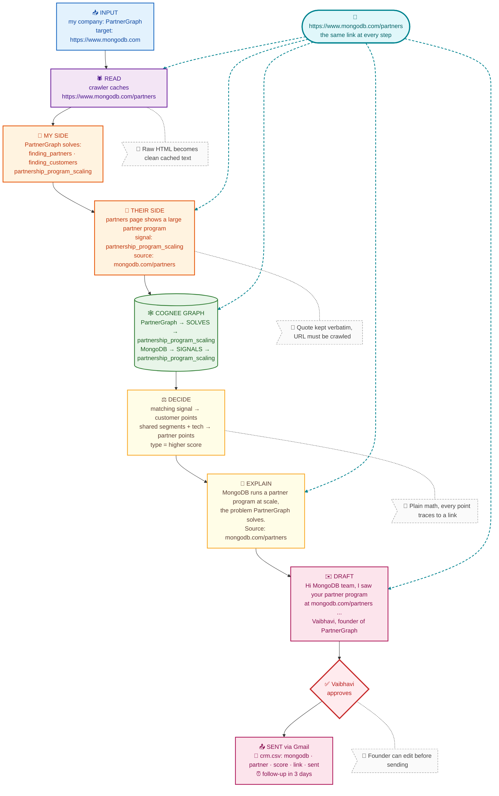

# PartnerGraph

**A personal business development agent for solo founders.** PartnerGraph reads company websites, finds who has the problem you solve (customers) and who serves the same buyers with a complementary product (partners), proves every match with source links, and sends outreach once you approve it.

Built solo at the Personal Agents Hackathon (tokens&, AWS Builder Loft SF, Nov 20 2026).

> For the demo, PartnerGraph found PartnerGraph's own first customers and partners.

## The problem

Solo founders can't afford a business development hire, meaning someone to research companies, find customers and partners, and reach out. Lead tools like Clay, Apollo and Common Room give you a contact database and a black-box score, and they only look for leads. A founder still has to work out why a company fits, whether they'd make a better partner than customer, and what to say.

## What it does

1. **Reads.** It crawls 6 to 9 pages per company (home, product, blog, careers, job posts, integrations) and caches them locally.
2. **Understands.** Gemini extracts a structured profile per company: capabilities, problems, segments, tech stack, and signals. Every signal keeps a verbatim quote and its source URL.
3. **Connects.** Profiles go into a cognee knowledge graph, which links your problems to the companies that show them.
4. **Scores.** Plain Python, no LLM, gives each target a customer score and a partner score. Every point traces back to a link.
5. **Explains.** The agent writes why each match fits, citing only URLs it actually crawled. A validator removes any URL it didn't crawl.
6. **Acts.** It drafts an email in your voice that cites one real signal. You edit it and approve it, then it sends over Gmail, logs a CRM row, and schedules a follow-up.

## End-to-end pipeline

Each box says what happens and what comes out of it.



## Worked example: one match, start to finish

How the agent decides MongoDB is a partner for PartnerGraph, and what it does about it.



**Color key:** 🔵 input · 🟣 crawl · 🟠 LLM extraction · 🟢 cognee graph · 🟡 scoring · 🩷 actions · 🔴 human approval · 🩵 the evidence link

The same link, `https://www.mongodb.com/partners`, travels through every step: it's crawled, becomes a signal, becomes a graph edge, adds to the score, is cited in the explanation, and is cited in the email. That's the evidence path.

## Knowledge graph schema

```
Me        --OFFERS-->         Capability --SOLVES--> Problem
Target    --HAS_SIGNAL-->     Problem
Signal    --FOUND_ON-->       SourceURL
Target    --SERVES-->         Segment   <--SERVES--  Me
Target    --USES-->           TechStack <--USES--    Me
```

**Customer path:** I solve problem X, and the target shows problem X in a job post, so the target is a likely customer. The job post URL is the proof.

**Partner path:** we serve the same segment and use the same tools, but sell different products, so we're a likely integration or referral partner.

## Scoring

**Customer score (0 to 100):** each target signal that matches one of my problems earns points: job post 3, blog post 2, product page 1, integrations page 1. The score is points / 8 x 100, capped at 100. A job post is weighted highest because hiring for a problem means they are spending money on it.

**Partner score (0 to 90):** an integration link between the two companies earns 40, segment overlap earns up to 30, and tech overlap earns up to 30. The total is scaled so the best partner in the batch gets 90.

If both scores are 50 or more, the type is "both". Otherwise it's whichever score is higher.

The LLM never sets a score. It only reads pages and writes explanations.

## Personal agent features

- **Founder profile:** name, company, goal (find customers or find partners), and email tone.
- **Goal-aware ranking:** switching the goal re-ranks the list.
- **Drafts in your voice:** first person, signed with your name, citing one real signal.
- **Human in the loop:** nothing sends until you approve.
- **Real actions:** a Gmail send, a CRM row, and a scheduled follow-up.

## Tech stack

Python 3.11, requests, BeautifulSoup, Pydantic, litellm with Gemini, cognee Cloud, Streamlit, APScheduler with SQLite job store, smtplib.

## Run it

```bash
python3.11 -m venv .venv && source .venv/bin/activate
pip install -r requirements.txt
cp .env.example .env   # fill in keys below

python crawl.py                          # cache target pages
python run_pipeline.py --refresh         # extract, score, explain
streamlit run app.py                     # open http://localhost:8501
```

`.env` keys:

```
COGNEE_SERVICE_URL=    # your cognee tenant URL
COGNEE_API_KEY=
GEMINI_API_KEY=
EXTRACT_MODEL=gemini/gemini-3.5-flash
MY_COMPANY_KEY=partnergraph
GMAIL_USER=
GMAIL_APP_PASSWORD=    # 16-char Gmail app password
DEMO_TO_EMAIL=
FOLLOWUP_MINUTES=2     # demo only; default is 3 days
```

## Design decisions

- **Deterministic scores:** judges and users can check every point against a link.
- **Controlled vocabulary:** my problems are extracted first and passed into every target extraction, so "ETL failures" and "pipeline reliability" map to the same problem ID and actually match.
- **Offline demo:** pages, profiles and explanations are cached, so the UI never calls the network until you hit send.
- **Validated citations:** explanations and emails can only cite URLs that were actually crawled.

## How it compares

| | Clay / Apollo / Common Room | PartnerGraph |
|---|---|---|
| User | Sales teams | One founder |
| Output | Contact list and score | Ranked customers and partners |
| Why | Black box | Evidence path with source links |
| Partners | No | Yes |
| Outreach | You write it | Drafted from a real signal, sent after approval |

## Roadmap

- Target discovery: "find 50 logistics companies in California"
- Fixed-scale partner score instead of batch-relative
- Continuous site monitoring that re-drafts outreach when a new signal appears
- Reply detection and multi-touch sequences
- LinkedIn and news signals
- HubSpot and Salesforce sync
- Gmail history check: follow up instead of cold-emailing someone you already talk to

## Author

Vaibhavi Phalle, backend engineer (FastAPI, Kafka, DAG orchestration, RAG).
